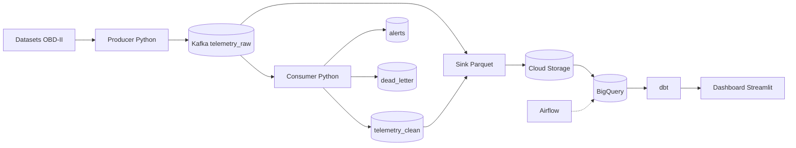

# Pipeline de télémétrie véhicule en temps réel

Pipeline data end-to-end : ingestion de données OBD-II en streaming (Kafka),
traitement, data lake Parquet (Cloud Storage), data warehouse BigQuery,
dbt, Airflow et dashboard Streamlit.

## Architecture prévue

## Statut

Phase 0 : mise en place du projet.
